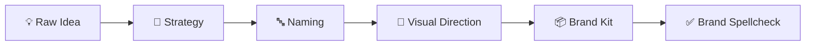
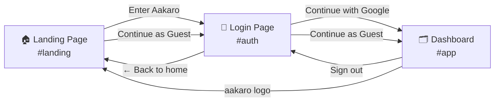
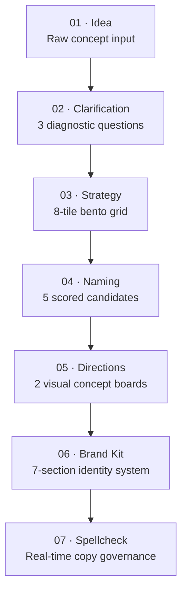

# AAKARO — Brand Identity Platform
## Complete Project Documentation

**Platform Architect:** Sankula Koteswara Rao  
**Version:** 1.0.0  
**Last Updated:** October 2026  
**Tech Stack:** Vanilla HTML5 · CSS3 · JavaScript (zero dependencies)  

---

## Table of Contents

1. [Project Overview](#1-project-overview)
2. [File Structure](#2-file-structure)
3. [Navigation & User Flow](#3-navigation--user-flow)
4. [Page-by-Page Breakdown](#4-page-by-page-breakdown)
5. [7-Stage Brand Journey](#5-7-stage-brand-journey)
6. [Design System](#6-design-system)
7. [State Management](#7-state-management)
8. [Button & Event Reference](#8-button--event-reference)
9. [Deterministic Intelligence Engine](#9-deterministic-intelligence-engine)
10. [Enterprise Deliverables](#10-enterprise-deliverables)

---

## 1. Project Overview

**Aakaro** (from Sanskrit: *"to give shape and form"*) is a zero-dependency, offline-first brand identity platform. It transforms raw business ideas into complete, production-ready brand systems through a guided 7-stage journey — all running entirely in the browser with no server, no API keys, and no installation.



### Key Advantages

| Feature | Detail |
|---|---|
| **Zero latency** | All generation is client-side — 0ms response time |
| **Offline-first** | Works with no internet connection after first load |
| **100% private** | No data ever leaves the user's device |
| **Zero cost** | No API calls, no subscriptions, no infrastructure |
| **WCAG compliant** | Color contrast validated mathematically |

---

## 2. File Structure

```
aakaro-clone/
├── index.html              ← Single-page HTML shell (all 3 views)
├── script.js               ← All app logic (~3,200 lines, IIFE pattern)
├── style.css               ← All styles (~2,300 lines, claymorphism)
├── ezgif-frame-240.jpg     ← Landing page background image
├── DOCUMENTATION.md        ← This file
└── assets/
    ├── fonts/              ← Custom typefaces
    ├── icons/              ← SVG icon assets
    └── images/
        └── landscape.svg   ← Auth page art panel background
```

> **Why a single HTML file?**  
> The entire app is a progressive Single-Page Application (SPA) — three distinct views (`landing`, `auth`, `app`) are pre-rendered in the DOM and toggled via JS. This enables instant transitions with zero network requests.

---

## 3. Navigation & User Flow

The app has a strict **3-step linear flow**:



### URL Hash Routing

| Hash | View Shown |
|---|---|
| *(no hash / anything else)* | Landing Page |
| `#auth` or `#login` | Login / Auth Page |
| `#app` | Workspace Dashboard |

### Default Startup

On first load (no saved state), the app **always starts on the Landing Page**. If a user has a saved session and navigates directly to `#app`, they land on the Dashboard.

---

## 4. Page-by-Page Breakdown

### 4.1 Landing Page (`#landing`)

The entry point of the app. Features a **full-viewport static background image** (`ezgif-frame-240.jpg`) with a dark vignette overlay and a centered hero card.

**Visual layout:**
```
┌──────────────────────────────────────────┐
│                                          │
│         [Full Viewport Image]            │
│          [Vignette Overlay]              │
│                                          │
│              A A K A R O                 │
│       Give your idea an identity.        │
│                                          │
│   [ Enter Aakaro → ]  [ Continue as Guest ] │
│                                          │
└──────────────────────────────────────────┘
```

**Buttons:**
- **Enter Aakaro** → navigates to Login page
- **Continue as Guest** → navigates to Login page

---

### 4.2 Login / Auth Page (`#auth`)

A split-card design matching the original Aakaro React reference exactly.

**Visual layout:**
```
┌─────────────────────────────────────────────────────────┐
│ ← Back to home                                          │
│                                                         │
│  ┌─────────────────────┬──────────────────────────┐    │
│  │  [landscape.svg bg] │   Aakaro                 │    │
│  │  aakaro             │   It starts with         │    │
│  │                     │   your idea.             │    │
│  │  Give your idea     │                          │    │
│  │  an identity.       │  [ Continue with Google ]│    │
│  │                     │  [ Continue as guest    ]│    │
│  │  Every idea starts  │                          │    │
│  │  somewhere.         │  One account.            │    │
│  │                     │  Room for new ideas.     │    │
│  └─────────────────────┴──────────────────────────┘    │
│                                                         │
│       A little spark. A new shape. Aakaro.              │
└─────────────────────────────────────────────────────────┘
```

**Buttons:**
- **← Back to home** (top-left) → Landing page
- **aakaro wordmark** (art panel, clickable) → Landing page
- **Continue with Google** → Sets Google session → Dashboard
- **Continue as guest** → Sets guest session → Dashboard

---

### 4.3 Workspace Dashboard (`#app`)

The full brand journey workspace. Contains:
- **Top Navbar** with the `aakaro` logo, theme toggle, "Start over" button, session pill, and **Sign out** button
- **Stage Rail** (left/top) showing the 7 workflow stages with progress indicators
- **Screen Viewport** (main area) rendering the active stage UI

**Navbar buttons:**
- **aakaro logo** (top-left) → Landing page
- **Theme toggle** → Switches light/dark mode (persisted to `localStorage`)
- **Start over** → Resets all state and returns to Stage 01
- **Session pill** → Navigates to Login page
- **Sign out** → Clears session → Login page

---

## 5. 7-Stage Brand Journey

Once in the Dashboard, users follow a sequential 7-stage pipeline:



---

### Stage 01 — Idea Extraction

**Goal:** Capture the founder's raw vision in plain language.

- Claymorphic textarea with real-time character metering
- Interactive journey roadmap sidebar
- Pre-filled placeholder to reduce blank-page anxiety
- Validates input is non-empty before proceeding

---

### Stage 02 — Clarification Framework

**Goal:** Sharpen the idea through 3 targeted diagnostic questions.

- Questions are dynamically selected based on detected domain (Tech / Creator / Enterprise)
- Stepper UI with **Q-Dots** (visual progress checkmarks)
- *"I'm not sure"* fallback option for each question for rapid alignment
- All 3 answers must be completed before unlocking Stage 03

---

### Stage 03 — Strategy Bento Grid

**Goal:** Generate the full brand positioning strategy across 8 modular tiles.

| Tile | Content |
|---|---|
| **One-Liner** | Core value proposition in one sentence |
| **Audience** | Primary demographic profile |
| **The Problem** | Acute market friction being resolved |
| **The Promise** | Measurable outcome guaranteed to users |
| **Differentiation** | Competitive advantage over alternatives |
| **Personality** | Tone attributes (e.g., *Welcoming, Focused, Honest*) |
| **Positioning** | Strategic market category definition |
| **Naming Territories** | 3 creative angles to guide name generation |

Every tile supports **click-to-edit inline modifications** with live state sync.

---

### Stage 04 — Naming Engine & Multi-Metric Evaluation

**Goal:** Generate 5 distinct name candidates and evaluate them against the locked strategy.

**Per candidate:**
- Territory alignment tag
- Linguistic note (phonetics, cadence, stress)
- 4-metric scoring: *Distinctiveness · Strategic Fit · Memorability · Extensibility* (1–5)
- Strengths and risk analysis

**Rules:**
- Maximum **2 names** may be shortlisted
- All rejected names are archived into **The Graveyard** with full evaluation records preserved

---

### Stage 05 — Visual Direction Boards

**Goal:** Generate 2 distinct visual concepts based on the 2 shortlisted names.

**Per concept:**
- 4-color palette (Primary · Secondary · Accent · Background) with usage rationale
- Typography pairing (Display + Body typeface)
- Logo & symbol concept description
- Abstract visual language / motif
- Tone statement (a stylized brand voice quote)

One direction is selected to proceed to Stage 06.

---

### Stage 06 — Comprehensive Brand Kit

**Goal:** Centralize the complete brand identity into a living, editable style guide.

**7 Sections:**

1. **Core Identity** — Brand name, descriptor, and official tagline
2. **Wordmark System** — Casing rules, tracking, and font weights
3. **Color Tokens** — Live swatches with hex validation and WCAG contrast checks
4. **Typography Guidelines** — Hierarchy for headlines, body copy, and line spacing
5. **Imagery Direction** — Composition guidelines and visual rhythm
6. **Voice & Tone Playbook** — Preferred vocabulary and forbidden phrases
7. **8 Brand Governance Rules** — Concrete rules for Voice, Language, and Visual Layout

---

### Stage 07 — Brand Spellcheck & Governance

**Goal:** Real-time quality control for marketing copy before it goes public.

- Scans copy against the 8 confirmed brand rules
- Flags corporate buzzwords: *"revolutionary", "best-in-class", "disruptive", "synergy"*
- Checks second-person *"you"* address perspective
- **One-click "Apply Fix"** replaces flagged content with grounded alternatives
- **Export Suite:** Download as Markdown or Print/PDF

---

## 6. Design System

### Themes

```
LIGHT THEME  →  Background: #F4F6FB  (clean editorial porcelain)
DARK THEME   →  Background: #090D16  (atmospheric deep space)
ACCENT       →  Electric Indigo: #3D5AE8  |  Soft Gold: #F1CB68
```

Theme is detected from OS preference on first load and persisted to `localStorage` under key `aakaro:theme`.

### Claymorphism UI

Every surface uses dual-layer drop shadows paired with crisp inner highlights:
```css
box-shadow:
  0 8px 32px rgba(0,0,0,0.10),       /* outer depth shadow */
  inset 0 1px 0 rgba(255,255,255,0.9); /* inner highlight */
```

This produces a **physical, tactile surface feel** without heavy 3D transforms.

### Bento Grid

Modular card-based layouts inspired by modern editorial dashboards. Cards are variable-width (1, 2, or 3 columns) based on content importance, creating natural visual hierarchy.

### Responsive Breakpoints

| Breakpoint | Target |
|---|---|
| `390px` | Mobile (iPhone-class) |
| `768px` | Tablet |
| `1024px` | Laptop |
| `1440px+` | Desktop / wide |

Typography uses `clamp()` math to scale fluidly across all breakpoints with zero media-query overrides.

---

## 7. State Management

All state lives in a single JS object inside the IIFE and is persisted to `localStorage` under key `aakaroProject`.

### State Shape

```js
state = {
  activeView: "landing",       // "landing" | "auth" | "app"
  currentStage: "idea",        // "idea" | "clarification" | "strategy" |
                               // "naming" | "directions" | "brand-kit" | "spellcheck"
  idea: {
    rawIdea: "..."
  },
  clarification: {
    questions: [],
    answers: [],
    completed: false,
    currentIndex: 0
  },
  strategy: {
    draft: null,
    confirmed: null,
    confirmedAt: null
  },
  naming: {
    candidates: [],
    evaluations: [],
    selectedIds: [],
    graveyardIds: [],
    generationStatus: "idle"   // "idle" | "ready" | "confirmed"
  },
  directions: {
    items: [],
    selectedDirectionId: null,
    status: "idle"             // "idle" | "generating" | "ready" | "confirmed"
  },
  brandKit: {
    draft: null,
    confirmed: null,
    status: "idle"             // "idle" | "ready" | "editing" | "confirmed"
  },
  session: {
    isLoggedIn: false,
    name: "Local session",
    email: "...",
    avatar: "A",
    method: "guest"            // "google" | "guest"
  },
  spellcheck: {
    originalContent: "",
    workingContent: "",
    review: null,
    status: "idle",            // "idle" | "reviewing" | "ready" | "complete"
    contentRevision: 0
  }
}
```

### Persistence Strategy

- `saveProject()` → `localStorage.setItem("aakaroProject", JSON.stringify(state))`
- `loadProject()` → deep-merges saved JSON over `getEmptyProject()` defaults (safe migration)
- **Sign out** → `state.session = null` (project data preserved, only auth cleared)
- **Start over** → full `state = getEmptyProject()` reset

---

## 8. Button & Event Reference

### Landing Page

| Button ID | Action |
|---|---|
| `btn-enter-workspace` | Navigate to Login page (`#auth`) |
| `btn-outro-guest` | Navigate to Login page (`#auth`) |

### Auth / Login Page

| Button ID | Action |
|---|---|
| `btn-auth-back-home` | Navigate to Landing page (`#landing`) |
| `art-wordmark-link` | Navigate to Landing page (`#landing`) |
| `btn-auth-google` | Set Google session → navigate to Dashboard (`#app`) |
| `btn-auth-guest` | Set Guest session → navigate to Dashboard (`#app`) |

### Dashboard Navbar

| Button ID | Action |
|---|---|
| `nav-brand-logo` | Navigate to Landing page (`#landing`) |
| `theme-toggle-btn` | Toggle light/dark theme |
| `btn-start-over` | Reset all state → return to Stage 01 |
| `nav-session-pill` | Navigate to Login page (`#auth`) |
| `btn-sign-out` | Clear session → navigate to Login page (`#auth`) |

---

## 9. Deterministic Intelligence Engine

Aakaro uses a **rule-based deterministic engine** instead of cloud LLMs.

| Factor | Cloud AI / LLM | Aakaro Engine |
|---|---|---|
| **Cost** | \$0.02–\$0.10 per generation + monthly bills | **\$0.00 — zero cost** |
| **Speed** | 3–15 seconds per screen | **0ms — instantaneous** |
| **Uptime** | Subject to API outages and rate limits | **100% — runs offline** |
| **Privacy** | Business ideas sent to cloud servers | **100% private — local only** |
| **Consistency** | Hallucinations and formatting drift | **100% deterministic output** |
| **Accessibility** | Colors may fail contrast | **WCAG 2.1 AA validated** |

---

## 10. Enterprise Deliverables

At the end of the 7-stage journey, Aakaro produces:

```
┌──────────────────────────────────────────────────────────────┐
│                      AAKARO DELIVERABLES                     │
├──────────────────────────────────┬───────────────────────────┤
│  1. Complete Strategic Brief     │  One-liner, Positioning,  │
│                                  │  Audience & Tone          │
│  2. Scored Naming Inventory      │  5 Evaluated Candidates   │
│                                  │  + Linguistic Notes       │
│  3. The Graveyard Archive        │  Full logs of rejected    │
│                                  │  names with evaluations   │
│  4. Two Visual Concept Boards    │  Color palettes, Type,    │
│                                  │  Symbols & Tone quotes    │
│  5. Living Brand Kit (7 Parts)   │  Tokens, Wordmarks,       │
│                                  │  Imagery & 8 Rules        │
│  6. Real-Time Copy Validator     │  Interactive Brand        │
│                                  │  Spellcheck tool          │
│  7. Multi-Format Export Package  │  Markdown style guide     │
│                                  │  & Print/PDF sheet        │
└──────────────────────────────────┴───────────────────────────┘
```

---

*Aakaro · Give your idea an identity. · © 2026 Sankula Koteswara Rao*
